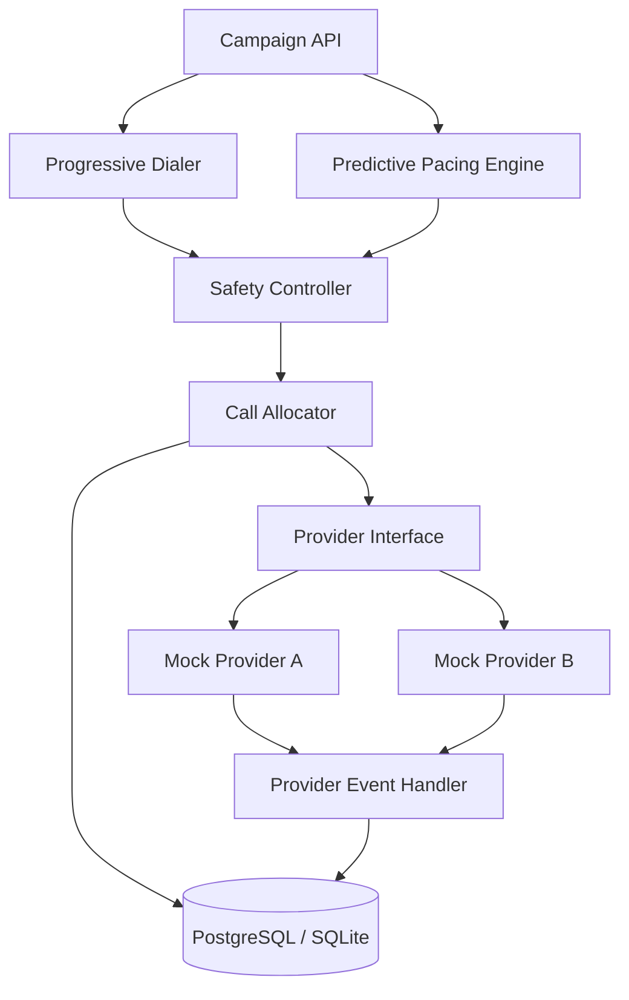

# Architecture

## Trust boundaries
The pacing engine is advisory only. It cannot import or invoke provider adapters.
The Safety Controller is the only component allowed to approve a batch. The allocator
uses database state to claim resources. Provider adapters are isolated behind a common
interface.

## State transitions
Agent: OFFLINE -> AVAILABLE -> RESERVED -> DIALING -> CONNECTED -> WRAP_UP -> AVAILABLE.
Calls: RESERVED -> INITIATED -> RINGING -> ANSWERED -> CONNECTED -> COMPLETED.
Failure and cancellation are terminal for a call. Late events cannot resurrect terminal
calls. Real systems need explicit timeouts and reconciliation for ambiguous provider states.

## Scaling considerations
At 100 agents, a single application process and relational database are adequate.
At 1,000 agents, queue contention, provider throughput and event processing are likely
bottlenecks; use indexed queue claims, worker pools, bounded concurrency and a shared
circuit-breaker state. At 10,000 agents, partition campaigns/queues, use durable event
transport, horizontally scaled workers, database sharding or carefully partitioned
ownership, and provider rate limits. Measure lock wait time and event lag before splitting
services.
